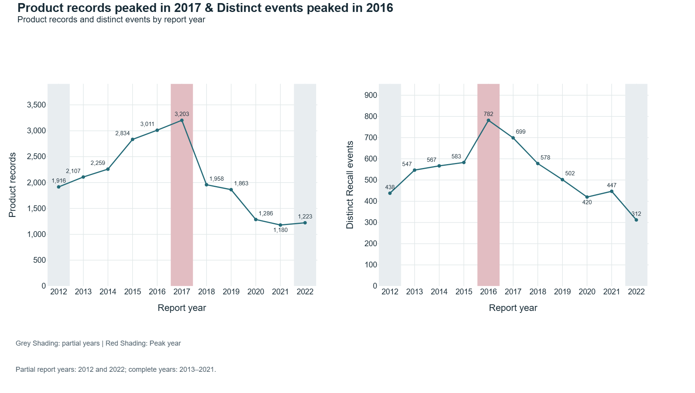
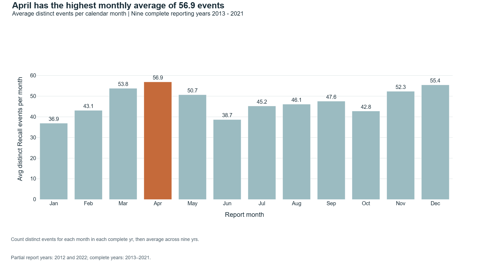
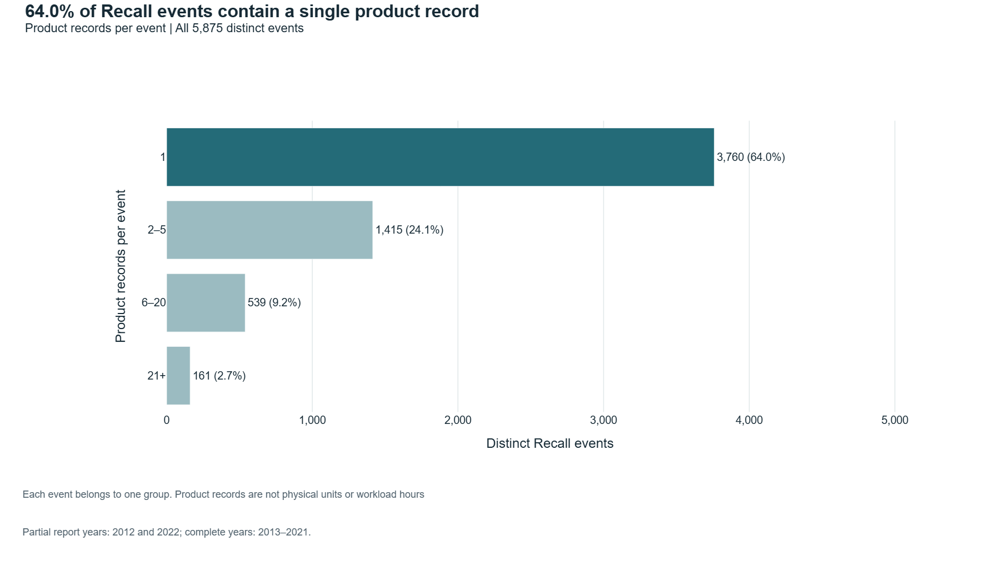
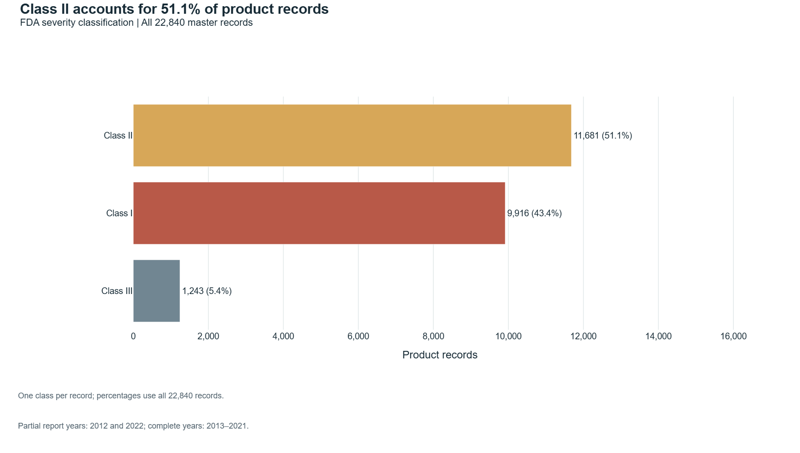
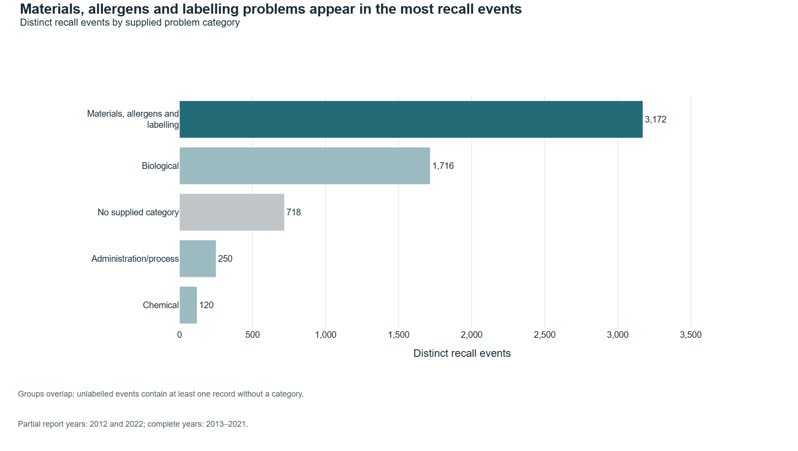
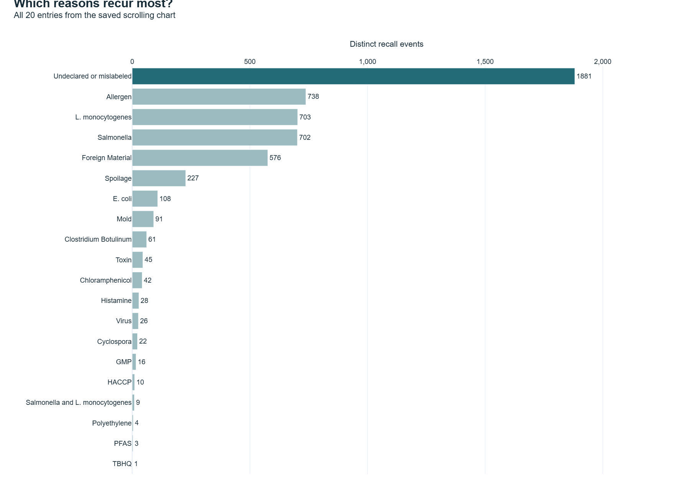
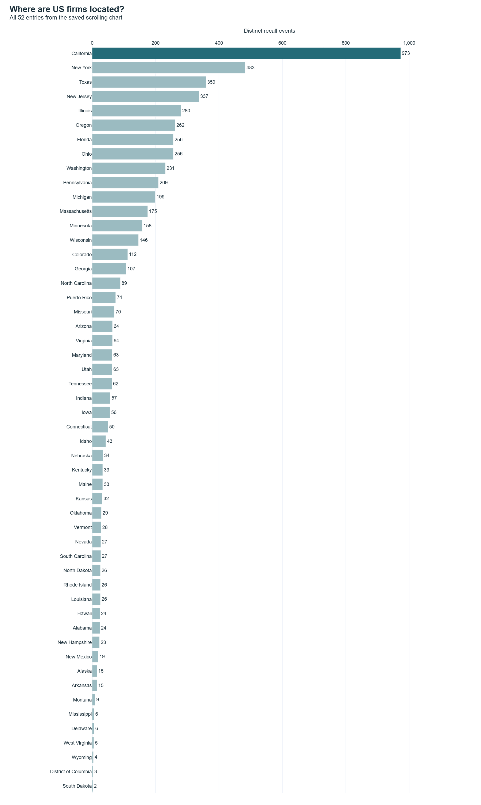
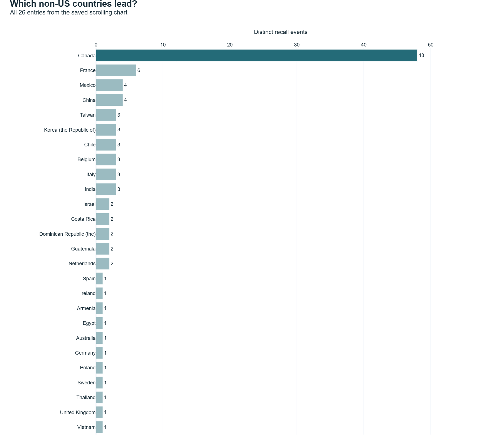
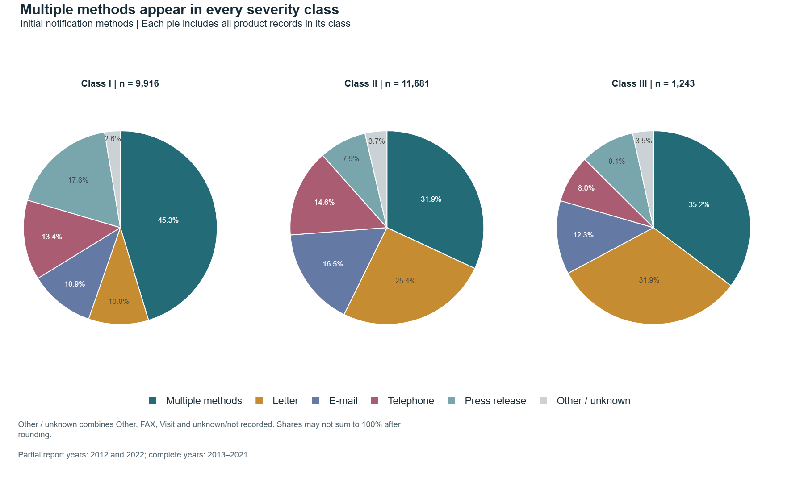
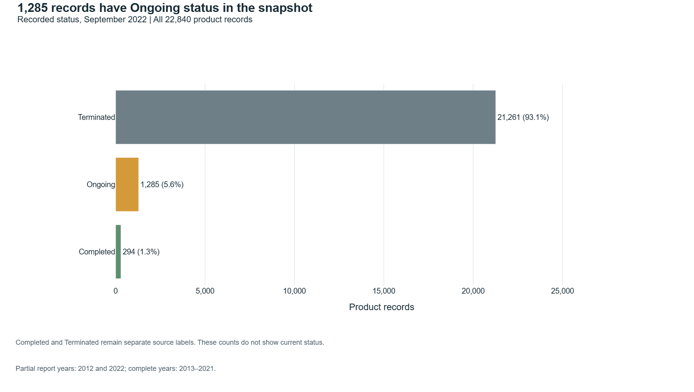

# FDA Food Recall Analysis
Historical food-enforcement analysis with distinct product-record and recall-event measures.

**Author:** Mayur More · **Context:** Academic project; not FDA-commissioned or endorsed.

[Python Notebook and Code](FDA_Food_Recall_Analysis.ipynb) · [Results](docs/RESULTS.md) · [Data & citations](docs/DATA.md) · [Methods](docs/METHODS.md)

## Project question
How do recorded workload, supplied issue categories, recalling-firm locations, initial notification and historical statuses vary?

The snapshot has **22,840 records** and **5,875 events**, with report dates **20 June 2012–31 August 2022**. Complete-year comparisons use 2013–2021.

Preview generated from the same historical master CSV; grey bars mark partial reporting years.

## Contributions
Reconciliation of labelled tables with master records, explicit units, ten analytical questions, chart presentation and qualified interpretation. Supplied labels and inherited cleaning come from the cited dataset/case study; see [contributions](docs/CONTRIBUTIONS.md).

## Selected historical findings
| Measure | Result |
|---|---:|
| Product-record peak, complete years | 3,203 in 2017 |
| Event peak, complete years | 782 in 2016 |
| Class II records | 11,681 (51.1%) |
| Single-record events | 3,760 (64.0%) |

## Ten questions, charts and answers

These static PNGs render the notebook’s existing saved Plotly figures. The interactive notebook plots remain unchanged. Scrolling rankings are expanded to show every entry; these images do not support hover or filtering. Results describe the historical snapshot, not current recall activity.

### 1. How does workload vary by year?

**Answer:** Product records peaked in 2017 with 3,203 records, while distinct recall events peaked in 2016 with 782 events. This shows us that record volume and event count don't always peak together, so both measures are useful when considering recall workload.

*Evidence: notebook cells 13 (saved chart) and 14 (interpretation); positions include Markdown cells.*

### 2. Which months were busiest on average?

**Answer:** Although April has the highest historical monthly avg at 56.9 distinct recall events, followed by December at 55.4 and March at 53.8. January is lower at 36.9. This suggests there are some seasonal variation in recall activity, so we can't conclude April was not necessarily the busiest month every year.

*Evidence: notebook cells 16 (saved chart) and 17 (interpretation); positions include Markdown cells.*

### 3. How broad is each recall event?

**Answer:** Most recall events involve relatively few product records. 3,760 events (64.0%) contain only one product record, and another 24.1% contain 2–5 records. Overall, 88.1% of events contain five or fewer records, showing that large multi-record recalls are comparatively uncommon..

*Evidence: notebook cells 19 (saved chart) and 20 (interpretation); positions include Markdown cells.*

### 4. Which FDA class is most frequent?

**Answer:** Class II is the most frequent class with 11,681 product records (51.1%), followed by Class I with 9,916 (43.4%) and Class III with 1,243 (5.4%). Class I and II together make up about 94.6% of records. However, frequency is not the same as severity  Class I represents the highest health hazard category, which makes it more concerning in such great volume.

*Evidence: notebook cells 22 (saved chart) and 23 (interpretation); positions include Markdown cells.*

### 5. Which categories recur most?

**Answer:** Materials, allergens and labelling is the most frequent problem category, appearing in 3,172 distinct recall events, followed by Biological issues with 1,716 events. This highlights labelling, allergen and material related problems as a major recurring pattern in most of the product recall reaons.

*Evidence: notebook cells 25 (saved chart) and 26 (interpretation); positions include Markdown cells.*

### 6. Which reasons recur most?

**Answer:** Undeclared or mislabeled products are the most frequent supplied recall reason, appearing in 1,881 distinct events. They are followed by Allergen issues (738), L. monocytogenes (703), Salmonella (702), and Foreign Material (576). This shows that labelling and declaration problems are especially common among the recorded recall reasons.

*Evidence: notebook cells 28 (saved chart) and 29 (interpretation); positions include Markdown cells.*

### 7. Where are US firms located?

**Answer:** California has the highest no. of US recall events with 973, followed by New York (483), Texas (359), New Jersey (337), and Illinois (280). California therefore shows a much larger concentration of recorded recall activity than other states, but firm location alone does not state consumer risk.

*Evidence: notebook cells 31 (saved chart) and 32 (interpretation); positions include Markdown cells.*

### 8. Which non-US countries lead?

**Answer:** Canada leads the 26 non-US countries with 48 recall events, followed by France. This can support international coordination, but firm location does not measure exposure or country risk.

*Evidence: notebook cells 34 (saved chart) and 35 (interpretation); positions include Markdown cells.*

### 9. How do methods differ by class?

**Answer:** Multiple notification methods is the most common approach across all FDA severity classes: 45.3% of Class I, 31.9% of Class II, and 35.2% of Class III records use multiple methods. This suggests that multi channel communication is widely used, especially for Class I recalls, but the data does not show which method is most effective.

*Evidence: notebook cells 37 (saved chart) and 38 (interpretation); positions include Markdown cells.*

### 10. What statuses were recorded?

**Answer:** Most product records are Terminated: 21,261 records (93.1%). A further 1,285 (5.6%) are Ongoing and 294 (1.3%) are Completed. This indicates that the vast majority of recalls had reached termination by the latest snapshot, while only a small share remained ongoing or completed under those recorded statuses.

*Evidence: notebook cells 40 (saved chart) and 41 (interpretation); positions include Markdown cells.*

## Run locally
Use Python 3.12. Start from this repository folder:
1. Create an environment: `python -m venv .venv`
2. Activate: Windows PowerShell `.\.venv\Scripts\Activate.ps1`; macOS/Linux `source .venv/bin/activate`
3. Install the checked environment: `python -m pip install -r requirements.txt`.
4. Obtain the compatible dataset using [DATA.md](docs/DATA.md); place archive.zip beside the notebook.
5. Launch `python -m jupyterlab`; open the notebook and Restart Kernel / Run All.

Six required CSVs must be at the archive root. The notebook does not require an API key. A current API extract alone will not reconstruct the supplied category/reason files.

## Viewing charts
The ten PNG charts above display directly in GitHub’s README. GitHub notebook previews may not display the saved Plotly/iframe outputs. [Download the HTML report](reports/FDA_Food_Recall_Analysis.html) and open the downloaded file in a browser for Plotly hover and scrolling charts. No separate dashboard edition or hosted live demo is included.

## Interpretation
This historical snapshot is not a live recall tracker. Firm location is not consumer-exposure geography. Counts do not establish risk, causality, staff hours, inspection need or communication effectiveness. Categories and event subtotals across periods/locations may overlap. Status is historical; openFDA warns against tracking recall lifecycle with its endpoint.

## Sources and reuse
- [Kaggle dataset](https://www.kaggle.com/datasets/chiyucheng/fda-food-enforcement-20082022).
- [Case study](https://www.kaggle.com/code/chiyucheng/fda-food-recall-case-study).
- [FDA definitions](https://www.fda.gov/safety/enforcement-reports/enforcement-report-information-and-definitions).
- [openFDA overview](https://open.fda.gov/apis/food/enforcement/).

Raw data is excluded. Kaggle metadata lists the dataset as CC0. The inherited case-study code-licence scope still needs confirmation.  No blanket open-source licence is asserted.
