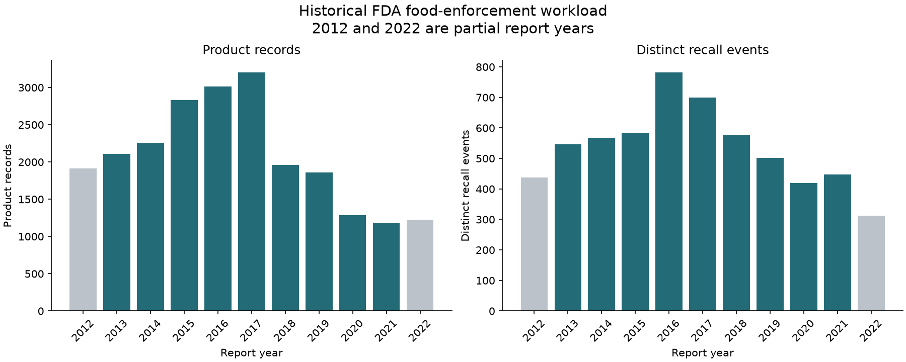

# FDA Food Recall Analysis
Historical food-enforcement analysis with distinct product-record and recall-event measures.

**Author:** Mayur More · **Context:** Academic project; not FDA-commissioned or endorsed.

[Notebook](FDA_Food_Recall_Analysis.ipynb) · [Results](docs/RESULTS.md) · [Data & citations](docs/DATA.md) · [Methods](docs/METHODS.md)

## Project question
How do recorded workload, supplied issue categories, recalling-firm locations, initial notification and historical statuses vary?

The snapshot has **22,840 records** and **5,875 events**, with report dates **20 June 2012–31 August 2022**. Complete-year comparisons use 2013–2021.

Preview generated from the same historical master CSV; grey bars mark partial reporting years.

## Contributions
Reconciliation of labelled tables with master records, explicit units, ten analytical questions, chart presentation and qualified interpretation. Supplied labels and inherited cleaning come from the cited dataset/case study; see [contributions](docs/CONTRIBUTIONS.md).

## Selected historical findings
| Measure | Result |
|---|---:|
| Product-record peak, complete years | 3,203 in 2017 |
| Event peak, complete years | 782 in 2016 |
| Class II records | 11,681 (51.1%) |
| Single-record events | 3,760 (64.0%) |

## Run locally
Use Python 3.12. Start from this repository folder:
1. Create an environment: `python -m venv .venv`
2. Activate: Windows PowerShell `.\.venv\Scripts\Activate.ps1`; macOS/Linux `source .venv/bin/activate`
3. Install the checked environment: `python -m pip install -r requirements-lock.txt` (or use requirements-dev.txt for only direct pins).
4. Obtain the compatible dataset using [DATA.md](docs/DATA.md); place archive.zip beside the notebook.
5. Launch `python -m jupyterlab`; open the notebook and Restart Kernel / Run All.

Six required CSVs must be at the archive root. The notebook does not require an API key. A current API extract alone will not reconstruct the supplied category/reason files.

## Viewing charts
GitHub notebook previews are static. [Download the HTML report](reports/FDA_Food_Recall_Analysis.html) and open the downloaded file in a browser for Plotly hover and scrolling charts. No separate dashboard edition or hosted live demo is included.

## Interpretation
This historical snapshot is not a live recall tracker. Firm location is not consumer-exposure geography. Counts do not establish risk, causality, staff hours, inspection need or communication effectiveness. Categories and event subtotals across periods/locations may overlap. Status is historical; openFDA warns against tracking recall lifecycle with its endpoint.

## Sources and reuse
- [Kaggle dataset](https://www.kaggle.com/datasets/chiyucheng/fda-food-enforcement-20082022).
- [Case study](https://www.kaggle.com/code/chiyucheng/fda-food-recall-case-study).
- [FDA definitions](https://www.fda.gov/safety/enforcement-reports/enforcement-report-information-and-definitions).
- [openFDA overview](https://open.fda.gov/apis/food/enforcement/).
